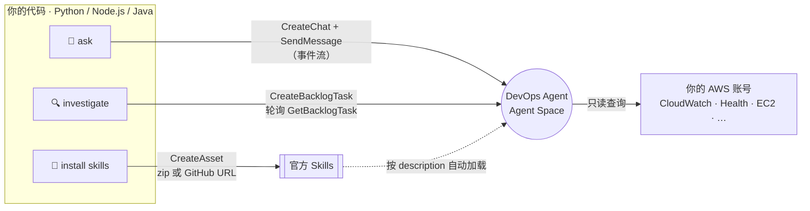
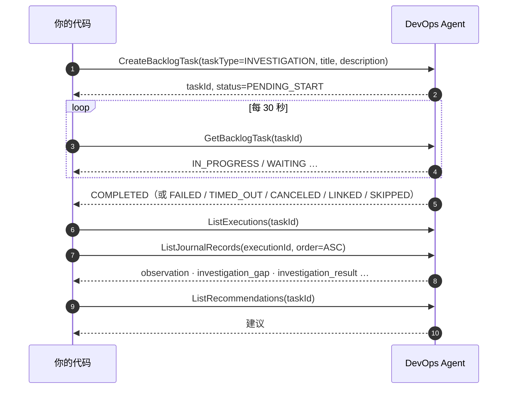

<p align="center">
  
</p>

<p align="center">
  <a href="python/"></a>
  <a href="nodejs/"></a>
  <a href="java/"></a>
  <a href="#-官方-skills"></a>
  <a href="#-测试"></a>
  <a href="LICENSE"></a>
</p>

<p align="center">
  用 <b>Python</b>、<b>Node.js</b> 或 <b>Java</b> 调用 <a href="https://docs.aws.amazon.com/devopsagent/latest/userguide/">AWS DevOps Agent</a>：<br>
  向 Agent 提问 · 发起故障调查并读取结论 · 把 <b>47 个官方 Skills</b> 一键装进 Agent Space
</p>

---

## 🧭 你想做什么？

| 我想… | 去这里 |
|---|---|
| 💬 用代码问 Agent 一个问题 | [三步上手](#-三步上手) → `ask` |
| 🔍 用代码发起一次故障调查，拿到结论 | [三步上手](#-三步上手) → `investigate` |
| 🧩 给 Agent Space 装官方 Skills | [官方 Skills](#-官方-skills) |
| 📄 打印一页纸发给同事 | [`docs/onepager.pdf`](docs/onepager.pdf) |
| 📚 查官方文档和 API | [`docs/references.md`](docs/references.md) |

## ⚡ 三步上手

**① 准备**：一个已关联 AWS 账号的 [Agent Space](https://docs.aws.amazon.com/devopsagent/latest/userguide/getting-started-with-aws-devops-agent-creating-an-agent-space.html)（在[支持的 Region](https://docs.aws.amazon.com/devopsagent/latest/userguide/about-aws-devops-agent-supported-regions.html) 里），给运行代码的身份附加 [`iam-policy.json`](iam-policy.json)。

**② 设置环境变量**（三种语言一样）：

```bash
export AGENT_SPACE_ID=<your-agent-space-id>
export AWS_REGION=us-east-1        # Agent Space 所在的 Region
```

**③ 选一种语言运行**：

<table>
<tr><th width="33%">🐍 Python</th><th width="33%">🟩 Node.js</th><th width="33%">☕ Java</th></tr>
<tr valign="top"><td>

```bash
cd python
pip install -r requirements.txt

python devops_agent_quickstart.py \
  ask "过去 24 小时有哪些告警？"

python devops_agent_quickstart.py \
  investigate "API 5xx 升高" \
  "14:05 UTC 起 5xx 超过 5%"

python install_skills.py install --all
```

</td><td>

```bash
cd nodejs
npm install

node src/quickstart.mjs \
  ask "过去 24 小时有哪些告警？"

node src/quickstart.mjs \
  investigate "API 5xx 升高" \
  "14:05 UTC 起 5xx 超过 5%"

node src/install-skills.mjs install --all
```

</td><td>

```bash
cd java
mvn -q package

java -jar target/quickstart.jar \
  ask "过去 24 小时有哪些告警？"

java -jar target/quickstart.jar \
  investigate "API 5xx 升高" \
  "14:05 UTC 起 5xx 超过 5%"

java -jar target/quickstart.jar \
  skills install --all
```

</td></tr>
<tr><td>Python 3.10+ · boto3 ≥ 1.43</td><td>Node.js 20+ · <code>@aws-sdk/client-devops-agent</code></td><td>Java 17+ · <code>software.amazon.awssdk:devopsagent</code> 2.57+</td></tr>
</table>

三种语言的命令、参数和输出格式完全一致。各语言的细节见 [`python/`](python/)、[`nodejs/`](nodejs/)、[`java/`](java/)。

## 🔧 工作原理



<details>
<summary><b>调查的完整调用顺序</b></summary>



- `WAITING` 表示还在等，继续轮询；`LINKED` 表示被合并到已有的同类调查；`SKIPPED` 表示被 triage 跳过。
- journal 里大部分记录是给网页用的（`message`、`utilization`、`ui_investigation_summary`），代码只打印有用的几类：`observation`、`investigation_gap`、`root_cause`、`mitigation`、`investigation_result`。

</details>

<details>
<summary><b>问答的事件流里有什么</b></summary>

`SendMessage` 返回一串内容块，每块有类型。**只有 `text` 是答案**：

| 块类型 | 内容 | 代码怎么处理 |
|---|---|---|
| `thinking` | Agent 的思考过程 | 不打印 |
| `tool_summary` | 「查询中…」「Done」 | 不打印 |
| `text` | **答案**，流式输出 | ✅ 打印 |
| `final_response` | 同一个答案再发一次 | 只在没有 `text` 时用 |
| `chat_title` | 会话标题 | 不打印 |

</details>

## 🧩 官方 Skills

[`tools-for-devops-agent/`](tools-for-devops-agent/) 是官方仓库 [aws/tools-for-devops-agent](https://github.com/aws/tools-for-devops-agent) 的完整副本（Apache-2.0，未改动，来源 commit 见 [UPSTREAM.md](tools-for-devops-agent/UPSTREAM.md)），包含 **47 个 Skills**、9 个 Custom Agents、6 个 MCP servers 和 CloudFormation 模板。

### Skill 是什么

一个 skill 是一个目录，核心是 `SKILL.md`：frontmatter 写 `name` 和 `description`，正文写排查步骤。装进 Agent Space 后**不用手动调用**：Agent 会根据 `description` 判断问题是否相关，相关就自动加载并按步骤做。

每个 skill 只在指定的 agent 类型里生效：

| | agent 类型 | 什么时候 |
|---|---|---|
| 💬 | `CHAT` | 你在聊天里提问时 |
| 🚦 | `INCIDENT_TRIAGE` | 新告警进来、决定要不要调查时 |
| 🔍 | `INCIDENT_RCA` | 调查根因时 |
| 🧪 | `RELEASE_TESTING` | 发布测试时 |

### 1️⃣ 准备权限：两个身份，别搞混

| 身份 | 用来做什么 | 要什么权限 |
|---|---|---|
| **你运行代码的身份**（用户或角色） | 调 API：提问、调查、装 skill | [`iam-policy.json`](iam-policy.json)，其中装 skill 需要 `aidevops:CreateAsset`、`aidevops:ListAssets` |
| **Agent Space 的角色** | Agent 去你账号里查资源 | 托管策略 `AIDevOpsAgentAccessPolicy`。部分 skill 要额外权限（见各 skill 的 README），可用官方模板一次补齐 ↓ |

```bash
aws cloudformation deploy \
  --template-file tools-for-devops-agent/cloudformation/devops-agent-skill-policies/devops-agent-skill-policies.yaml \
  --stack-name devops-agent-skill-policies \
  --parameter-overrides ExistingRoleName=<Agent Space 的角色名> \
  --capabilities CAPABILITY_NAMED_IAM
```

### 2️⃣ 安装：三种方式

> [!TIP]
> **推荐用代码批量装**：`install --all` 一次装好 35 个通用 skill，已经装过的会自动跳过，可以重复运行。

**方式 A：代码批量装（推荐）**

```bash
cd python   # 或 nodejs / java，命令相同
python install_skills.py list                                     # 看全部 47 个和各自的 agent 类型
python install_skills.py install --all                            # 装 35 个通用的
python install_skills.py install aws-routing service-quota-check  # 只装指定的
python install_skills.py installed                                # 看已经装了哪些
```

<details>
<summary><code>--all</code> 默认跳过哪 12 个？为什么？</summary>

| 跳过的 | 原因 | 要装的话 |
|---|---|---|
| `crm-production-investigation-guidelines` | 一个演示 CRM 应用的 triage 规则，会**关闭所有告警合并**，装进真实环境会改变 triage 行为 | 加 `--include-examples`，或者按名字装 |
| `skip-scheduled-maintenance` | 维护窗口写死为 2025-03-15，要先改成你的时间 | 同上 |
| Honeycomb ×7、Grafana、Sumo Logic、Wiz | 要先在 Agent Space 接入对应的第三方工具，否则装了也用不上 | 加 `--include-third-party` |

</details>

**方式 B：控制台从 GitHub 导入**

Agent Space 网页 → **Knowledge** → **Skills** → **Add skill** → **Import from repository**，填 skill 目录的 URL，例如 `https://github.com/aws/tools-for-devops-agent/tree/main/skills/aws-routing`，再选 agent 类型（见下面目录里的图标）。官方更新后点 **Sync** 即可。代码里对应的是 `install <skill> --from-github`。

> [!IMPORTANT]
> 从 GitHub 导入前，Agent Space 必须先**关联一个 GitHub 账号**，否则会报错：`No GitHub access is configured for the repository's host`。不想关联 GitHub 就用方式 A 或 C（上传 zip）。

**方式 C：手动上传 zip**

```bash
python install_skills.py zip aws-routing    # 生成 dist/aws-routing.zip
```

在 **Add skill** → **Upload skill** 上传。脚本只打包 Agent 运行时读的 `SKILL.md`、`references/`、`assets/`，去掉 `evals/`、`README.md` 这些开发文件。限制：最大 6 MB，不能有 `scripts/` 目录（47 个都满足，最大约 250 KB）。

### 3️⃣ 验证是否生效

问一个和 skill 相关的问题，让 Agent 说明用了哪个 skill：

```bash
python devops_agent_quickstart.py ask "过去 7 天有没有影响我账号的 AWS Health 事件？说明你用了哪个 skill。"
```

> 实测回答节选：「……这次我用的是 **aws-health-events** 这个 skill 来查询和分析 AWS Health 事件。」

没生效的话，检查 skill 状态是否 **Active**、agent 类型是否包含 `CHAT`。

### 4️⃣ 先装哪几个

| 目的 | 推荐 |
|---|---|
| 🚨 所有故障调查 | `aws-health-events` · `support-cases` · `investigation-cost-guardrail` |
| 🌐 网络问题 | `aws-routing` · `aws-vpc-dns-investigation` · `aws-natgw-traffic-analysis` |
| 📈 限流和容量 | `service-quota-check` |
| 🩺 定期体检 | `aws-backup-coverage-review` · `storage-s3-resiliency-expertise` · 各服务的 `*-operation-review` |

### 📚 全部 47 个 Skills

图标表示生效的 agent 类型：💬 CHAT · 🚦 INCIDENT_TRIAGE · 🔍 INCIDENT_RCA · 🧪 RELEASE_TESTING。⚠️ 示例 = 先改再用；🔌 需接入 = 要先接第三方工具。

<!-- skills-catalog:start -->
<details>
<summary><b>🚨 每次调查先用</b>（3 个）</summary>

| Skill | 生效于 | 做什么 |
|---|---|---|
| [`aws-health-events`](tools-for-devops-agent/skills/aws-health-events/) | 💬 🔍 | 调查开头先查 AWS Health 事件（服务故障、计划变更、账号通知），判断是不是 AWS 侧问题 |
| [`support-cases`](tools-for-devops-agent/skills/support-cases/) | 💬 🔍 | 调查开头先查历史 Support 工单，找症状相似的旧事故 |
| [`investigation-cost-guardrail`](tools-for-devops-agent/skills/investigation-cost-guardrail/) | 🔍 | 调查时控制成本：调用收费 API 前先估价，限制 Athena、S3 扫描等贵操作 |

</details>

<details>
<summary><b>🌐 网络</b>（3 个）</summary>

| Skill | 生效于 | 做什么 |
|---|---|---|
| [`aws-routing`](tools-for-devops-agent/skills/aws-routing/) | 💬 🔍 | AWS 会选哪条路：Cloud WAN、DX Gateway、TGW 路由表、ECMP、VPC 最长前缀、BGP 流量工程 |
| [`aws-vpc-dns-investigation`](tools-for-devops-agent/skills/aws-vpc-dns-investigation/) | 💬 🔍 | VPC 内域名解析不对（NXDOMAIN、SERVFAIL、解析到公网地址），或改 DNS 前做检查 |
| [`aws-natgw-traffic-analysis`](tools-for-devops-agent/skills/aws-natgw-traffic-analysis/) | 💬 | NAT 网关里走了什么流量、为什么走这条路、怎么降低 NAT 费用 |

</details>

<details>
<summary><b>📦 容器</b>（4 个）</summary>

| Skill | 生效于 | 做什么 |
|---|---|---|
| [`aws-eks-operations-review`](tools-for-devops-agent/skills/aws-eks-operations-review/) | 💬 | 按最佳实践给 EKS 集群打分：运维、安全、升级前检查、资源清单 |
| [`eks-upgrade-readiness`](tools-for-devops-agent/skills/eks-upgrade-readiness/) | 💬 | EKS 升级前评估：版本偏差、废弃 API、插件兼容、升级计划 |
| [`aws-eks-healthdashboard`](tools-for-devops-agent/skills/aws-eks-healthdashboard/) | 💬 | EKS 集群现在健康吗：控制面、节点、工作负载一页看清 |
| [`ecs-operation-review`](tools-for-devops-agent/skills/ecs-operation-review/) | 💬 | ECS 运维评审：6 个维度，7 天指标基线，推荐告警阈值 |

</details>

<details>
<summary><b>🗄️ 数据库和数据</b>（7 个）</summary>

| Skill | 生效于 | 做什么 |
|---|---|---|
| [`database-rds-devops`](tools-for-devops-agent/skills/database-rds-devops/) | 💬 🔍 | Aurora MySQL / PostgreSQL 数据库内部诊断：缓冲池、连接、锁、复制、索引（需 RDS Data API） |
| [`rds-operation-review`](tools-for-devops-agent/skills/rds-operation-review/) | 💬 | 按 Well-Architected 评审 RDS 和 Aurora：可用性、安全、性能、成本 |
| [`database-migration-service-expertise`](tools-for-devops-agent/skills/database-migration-service-expertise/) | 💬 | DMS 运维评审和排障：最佳实践、性能、成本、切换指导 |
| [`redshift-support-specialist`](tools-for-devops-agent/skills/redshift-support-specialist/) | 💬 | Redshift 查询调优、运维评审和成本优化，支持预置集群和 Serverless |
| [`msk-operations`](tools-for-devops-agent/skills/msk-operations/) | 💬 | Amazon MSK（Kafka）运维、排障和健康评估，支持 Standard 和 Express broker |
| [`analytics-opensearch-expertise`](tools-for-devops-agent/skills/analytics-opensearch-expertise/) | 💬 | OpenSearch 域体检：集群健康、分片、性能、安全、成本（只读） |
| [`firehose-operation-review`](tools-for-devops-agent/skills/firehose-operation-review/) | 💬 | 按 Well-Architected 评审 Amazon Data Firehose 投递流 |

</details>

<details>
<summary><b>💾 存储和备份</b>（4 个）</summary>

| Skill | 生效于 | 做什么 |
|---|---|---|
| [`storage-s3-resiliency-expertise`](tools-for-devops-agent/skills/storage-s3-resiliency-expertise/) | 💬 🔍 | S3 存储桶的韧性、安全和数据保护评审（9 个维度） |
| [`aws-backup-coverage-review`](tools-for-devops-agent/skills/aws-backup-coverage-review/) | 💬 | 查哪些资源没被 AWS Backup 保护，评估备份频率、保留期、跨区和跨账号复制 |
| [`aws-fsxn-operations-review`](tools-for-devops-agent/skills/aws-fsxn-operations-review/) | 💬 | FSx for NetApp ONTAP 运维评审：备份、可观测性、安全等 |
| [`storage-fsx-windows-sla-optimizer`](tools-for-devops-agent/skills/storage-fsx-windows-sla-optimizer/) | 💬 🔍 | FSx for Windows 的 SLA、可用性和成本评审（7 个维度） |

</details>

<details>
<summary><b>🤖 AI/ML</b>（7 个）</summary>

| Skill | 生效于 | 做什么 |
|---|---|---|
| [`bedrock-operation-review`](tools-for-devops-agent/skills/bedrock-operation-review/) | 💬 | 按 Well-Architected 评审 Bedrock 工作负载：安全、性能、成本 |
| [`bedrock-adoption-readiness`](tools-for-devops-agent/skills/bedrock-adoption-readiness/) | 💬 | Bedrock 上生产前检查：IAM 治理、数据保留（ZDR）、配额余量、可观测性 |
| [`sagemaker-ai-ops-review`](tools-for-devops-agent/skills/sagemaker-ai-ops-review/) | 💬 | SageMaker AI 运维评审：端点、训练任务、Pipeline、Studio |
| [`aiml-gpu-training-cluster-investigation`](tools-for-devops-agent/skills/aiml-gpu-training-cluster-investigation/) | 💬 🔍 | 排查 GPU 训练/推理集群（HyperPod、ParallelCluster、EC2/EKS GPU） |
| [`aiml-access-diagnostics`](tools-for-devops-agent/skills/aiml-access-diagnostics/) | 💬 🔍 | 排查 Bedrock / SageMaker 的 IAM 拒绝：逐跳查调用方、PassRole、信任策略、SCP，给出最小策略 |
| [`agentcore-ops-review`](tools-for-devops-agent/skills/agentcore-ops-review/) | 💬 | 按 Well-Architected 评审 AgentCore：Runtime 韧性、Gateway、Memory、资源使用 |
| [`agentcore-observability-setup`](tools-for-devops-agent/skills/agentcore-observability-setup/) | 💬 | 检查并补齐 Bedrock AgentCore 的可观测性，能追踪 agent 推理、发现静默失败 |

</details>

<details>
<summary><b>💰 成本</b>（4 个）</summary>

| Skill | 生效于 | 做什么 |
|---|---|---|
| [`devops-agent-cost-insights`](tools-for-devops-agent/skills/devops-agent-cost-insights/) | 💬 | DevOps Agent 自己花了多少钱、花在哪：按 Agent Space 和角色拆分 |
| [`cloudtrail-cost-optimization`](tools-for-devops-agent/skills/cloudtrail-cost-optimization/) | 💬 | 找出并量化 CloudTrail 的省钱空间，解释费用为什么涨 |
| [`config-cost-optimization`](tools-for-devops-agent/skills/config-cost-optimization/) | 💬 | 找出并量化 AWS Config 的省钱空间，解释配置项为什么暴涨 |
| [`guardduty-cost-optimization`](tools-for-devops-agent/skills/guardduty-cost-optimization/) | 💬 | 找出并量化 GuardDuty 的省钱空间，找出贵的防护计划 |

</details>

<details>
<summary><b>📈 容量和大活动</b>（2 个）</summary>

| Skill | 生效于 | 做什么 |
|---|---|---|
| [`service-quota-check`](tools-for-devops-agent/skills/service-quota-check/) | 💬 🔍 | 出现限流、LimitExceeded 时检查服务配额，也用于容量规划 |
| [`live-streaming-event-readiness-review`](tools-for-devops-agent/skills/live-streaming-event-readiness-review/) | 💬 | 大型直播（比赛、演唱会、发布会）前的只读就绪检查：扛不扛得住峰值 |

</details>

<details>
<summary><b>🔐 安全</b>（2 个）</summary>

| Skill | 生效于 | 做什么 |
|---|---|---|
| [`enrich-with-aws-security-agent`](tools-for-devops-agent/skills/enrich-with-aws-security-agent/) | 💬 🔍 | 故障可能有安全原因时（认证失败、注入攻击等），结合 AWS Security Agent 的发现 |
| [`wiz-security-context`](tools-for-devops-agent/skills/wiz-security-context/) 🔌 需接入 | 💬 🔍 | 资源出现异常（CPU 飙升、异常流量等）时，用 Wiz 判断是否和安全有关（需接入 Wiz） |

</details>

<details>
<summary><b>🔭 第三方可观测性</b>（9 个）</summary>

| Skill | 生效于 | 做什么 |
|---|---|---|
| [`honeycomb-production-investigation`](tools-for-devops-agent/skills/honeycomb-production-investigation/) 🔌 需接入 | 🚦 🔍 💬 | 用 Honeycomb 遥测找根因：延迟、错误、发布回归、依赖故障（需接入 Honeycomb） |
| [`honeycomb-query-patterns`](tools-for-devops-agent/skills/honeycomb-query-patterns/) 🔌 需接入 | 🔍 💬 | 写和读 Honeycomb 查询：百分位、热力图、关系字段（需接入 Honeycomb） |
| [`honeycomb-metrics-queries`](tools-for-devops-agent/skills/honeycomb-metrics-queries/) 🔌 需接入 | 🔍 💬 | 查询 Honeycomb 的 OpenTelemetry 指标数据集（需接入 Honeycomb） |
| [`honeycomb-slos-and-triggers`](tools-for-devops-agent/skills/honeycomb-slos-and-triggers/) 🔌 需接入 | 🚦 🔍 💬 | 解读 Honeycomb 的 SLO、错误预算消耗和触发器（需接入 Honeycomb） |
| [`honeycomb-create-board`](tools-for-devops-agent/skills/honeycomb-create-board/) 🔌 需接入 | 🔍 💬 | 按 SLO 和查询设计 Honeycomb 看板（需接入 Honeycomb） |
| [`honeycomb-observability-fundamentals`](tools-for-devops-agent/skills/honeycomb-observability-fundamentals/) 🔌 需接入 | 💬 | 回答可观测性概念问题：宽事件、高基数、指标和日志的区别 |
| [`honeycomb-verify-recent-trace`](tools-for-devops-agent/skills/honeycomb-verify-recent-trace/) 🔌 需接入 | 🧪 💬 | 发布或测试后，在 Honeycomb 找到最新的 trace 并总结（需接入 Honeycomb） |
| [`grafana-cloud-investigation`](tools-for-devops-agent/skills/grafana-cloud-investigation/) 🔌 需接入 | 💬 🚦 🔍 | 用 Grafana Cloud 的遥测数据调查故障（需接入 Grafana Cloud） |
| [`sumo-logic-investigator`](tools-for-devops-agent/skills/sumo-logic-investigator/) 🔌 需接入 | 💬 🚦 🔍 | 用 Sumo Logic 的日志、告警、SIEM 调查故障（需接入 Sumo Logic） |

</details>

<details>
<summary><b>🧪 示例（先改再用）</b>（2 个）</summary>

| Skill | 生效于 | 做什么 |
|---|---|---|
| [`skip-scheduled-maintenance`](tools-for-devops-agent/skills/skip-scheduled-maintenance/) ⚠️ 示例 | 🚦 | 演示用：维护窗口内跳过中低优先级告警，窗口时间写死为 2025-03-15，要先改 |
| [`crm-production-investigation-guidelines`](tools-for-devops-agent/skills/crm-production-investigation-guidelines/) ⚠️ 示例 | 🚦 | 演示用：一个 CRM 示例应用的 triage 规则（会关闭告警合并），只作模板 |

</details>

<!-- skills-catalog:end -->

### ✍️ 写自己的 skill

复制一个官方 skill 当模板，改 `name`、`description` 和步骤，再用上面任一方式安装。**`description` 最关键**：写清楚什么症状、什么服务、什么错误时用它，太笼统的话 Agent 会直接跳过。详见[官方 Skills 文档](https://docs.aws.amazon.com/devopsagent/latest/userguide/about-aws-devops-agent-devops-agent-skills.html)。

<details>
<summary><b>其他官方工具：Custom Agents、MCP servers、CloudFormation</b></summary>

- **Custom Agents**（[`custom-agents/`](tools-for-devops-agent/custom-agents/)，9 个）：健康报告、运维评审、EKS 评审、配额监控、工单报告、成本看板等，可以定时运行。
- **MCP servers**（[`mcp/`](tools-for-devops-agent/mcp/)，6 个）：EKS 节点诊断、VPC DNS 诊断、RDS、Redshift、ECS 日志、EMR Spark。
- **CloudFormation**（[`cloudformation/`](tools-for-devops-agent/cloudformation/)）：
  - `devops-agent-alarm-investigations`：CloudWatch 告警自动变成调查，用 EventBridge，不用写代码。
  - `devops-agent-skill-policies`：给 Agent Space 角色补齐 skills 需要的权限。

</details>

> [!NOTE]
> 官方 skills 是 sample code。上生产前请先在非生产环境测试，并检查 IAM 权限。最新版本以[官方仓库](https://github.com/aws/tools-for-devops-agent)为准。

## ✅ 测试

**真实环境测试**（2026-11-04，us-east-1 的测试用 Agent Space，三种语言都跑了一遍）：

| 功能 | 🐍 Python | 🟩 Node.js | ☕ Java | 怎么核对的 |
|---|:-:|:-:|:-:|---|
| `ask` 问答 | ✅ | ✅ | ✅ | 三种语言都答「27 个 S3 bucket」，和 S3 API 直接查的一致 |
| `investigate` 调查 | ✅ | ✅ | ✅ | 约 1.5 分钟完成，结论「过去 1 小时无告警」和 CloudWatch API 一致 |
| 上传 zip 安装 skill | ✅ | ✅ | ✅ | 服务端文件列表和本地 `SKILL.md` + `references/` 一致 |
| 已装的自动跳过（跨语言） | ✅ | ✅ | ✅ | Java 识别出 Python、Node 装的 skill |
| 没关联 GitHub 时 `--from-github` | ✅ | ✅ | ✅ | 打印一行原因，继续下一个，退出码 1 |
| skill 生效 | ✅ | | | Agent 回答里说明用了 `aws-health-events` |

**离线测试**（不需要 AWS 账号）：

```bash
cd python && python tests/test_quickstart.py && python tests/test_install_skills.py   # Stubber，按官方 API 模型校验请求
cd nodejs && npm test                                                                  # node:test + aws-sdk-client-mock
cd java   && mvn test                                                                  # JUnit 5 + Mockito
```

加 `--online`（Python）或 `ONLINE=1`（Node.js / Java）会另外检查 47 个 GitHub 导入 URL 都能打开。

## ⚠️ 实测踩过的坑

| 现象 | 原因 | 本仓库的处理 |
|---|---|---|
| 问答的答案打印了两遍，还夹着「Done」和标题 | 事件流有多种内容块，`text` 和 `final_response` 是同一个答案 | 只打印 `text` 块 |
| 调查过程的中文全是 `\u6d4b\u8bd5` 这样的转义 | journal 记录的 `content` 是 **JSON 字符串**，不是对象 | 先解析 JSON，只打印有用的记录类型 |
| 调查一直轮询不结束 | 新版 API 增加了 `SKIPPED` 状态 | `SKIPPED` 算结束，`WAITING` 继续轮询 |
| `--from-github` 报 `ValidationException` | Agent Space 没关联 GitHub | 打印原因，继续装下一个 |
| boto3 没有 `create_asset` | Asset API 从 boto3 1.43 才有，需要 Python 3.10+ | `requirements.txt` 写 `boto3>=1.43` |
| Java SDK 没有 `sourceUrl` | 2.57 之前的版本没有 | `pom.xml` 用 2.57.8 |
| Lambda 里没有 `devops-agent` 客户端 | Lambda 自带的 SDK 版本太旧 | 把新版 SDK 一起打包 |

## 📁 目录结构

```
.
├── python/                    🐍 devops_agent_quickstart.py · install_skills.py · tests/
├── nodejs/                    🟩 src/quickstart.mjs · src/install-skills.mjs · test/
├── java/                      ☕ src/main/java/quickstart/{Main,QuickStart,Skills}.java · src/test/
├── iam-policy.json            三种语言共用的最小权限
├── docs/
│   ├── onepager.html / .pdf   一页纸指南（A4）
│   ├── references.md          官方文档和 API 汇总
│   └── assets/banner.svg
├── scripts/skills_catalog.py  从 SKILL.md 生成上面的 skills 目录
└── tools-for-devops-agent/    官方 skills / custom agents / MCP servers 副本（Apache-2.0）
```

## 📄 License

本仓库自己的代码和文档：MIT-0，见 [LICENSE](LICENSE)。`tools-for-devops-agent/` 目录：Apache-2.0，见 [LICENSE](tools-for-devops-agent/LICENSE) 和 [NOTICE](tools-for-devops-agent/NOTICE)。
