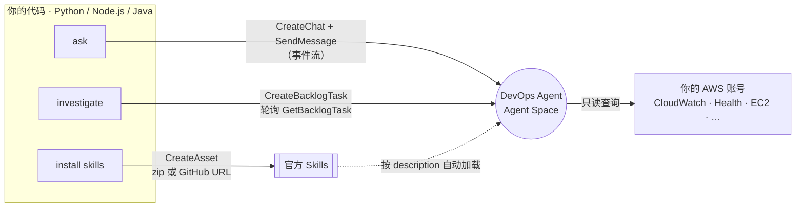
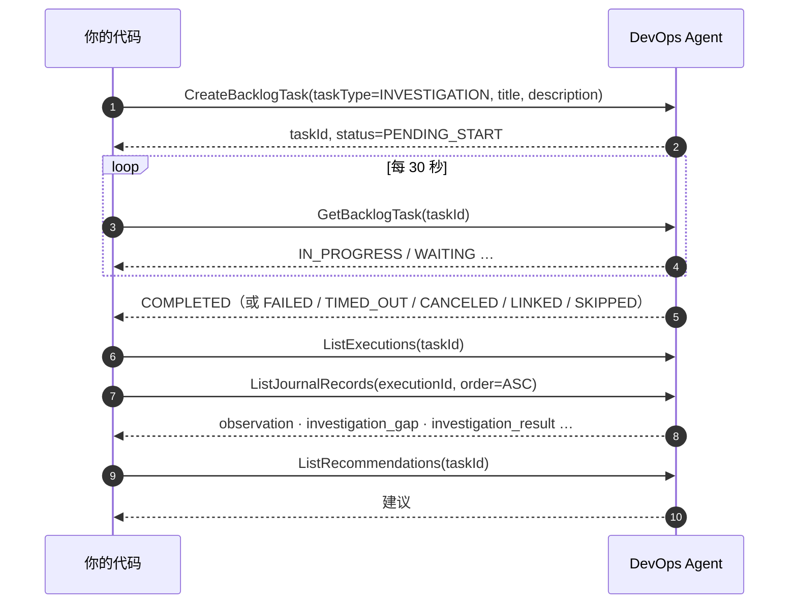

<p align="center">
  
</p>

<p align="center">
  <a href="python/"></a>
  <a href="nodejs/"></a>
  <a href="java/"></a>
  <a href="#官方-skills"></a>
  <a href="#测试"></a>
  <a href="LICENSE"></a>
</p>

用 Python、Node.js 或 Java 调用 [AWS DevOps Agent](https://docs.aws.amazon.com/devopsagent/latest/userguide/)：提问、发起故障调查，并读取调查结论和建议。本仓库还提供 47 个官方 Skills 的安装工具；`install --all` 默认安装其中 35 个通用 Skills，示例和第三方集成按需安装。

## 快速开始

### 准备环境

- 准备一个已关联 AWS 账号的 [Agent Space](https://docs.aws.amazon.com/devopsagent/latest/userguide/getting-started-with-aws-devops-agent-creating-an-agent-space.html)，位于[支持的 Region](https://docs.aws.amazon.com/devopsagent/latest/userguide/about-aws-devops-agent-supported-regions.html)。
- 给**运行代码的身份**附加 [`iam-policy.json`](iam-policy.json)。可将其中的 `Resource` 改为你的 Agent Space ARN，收紧权限。
- 选择一种语言：

| 语言 | 要求 |
|---|---|
| Python | Python 3.10+，boto3 ≥ 1.43 |
| Node.js | Node.js 20+，`@aws-sdk/client-devops-agent` |
| Java | Java 17+，Maven，`software.amazon.awssdk:devopsagent` 2.57+ |

### 设置环境变量

三种语言使用相同的环境变量：

```bash
export AGENT_SPACE_ID=<your-agent-space-id>
export AWS_REGION=us-east-1        # Agent Space 所在的 Region
export MAX_WAIT_MINUTES=60         # 可选：investigate 最多等多久
```

没设 `AWS_REGION` 时用 `AWS_DEFAULT_REGION`，都没有就用 `us-east-1`。

### 选择一种语言运行

以下命令分别演示提问、调查和批量安装 Skills。安装前请先阅读[官方 Skills](#官方-skills)中的权限与默认跳过规则。

**Python**

```bash
cd python
pip install -r requirements.txt

python devops_agent_quickstart.py ask "过去 24 小时有哪些告警？"

python devops_agent_quickstart.py investigate "API 5xx 升高" "14:05 UTC 起 5xx 超过 5%"

python install_skills.py install --all
```

**Node.js**

```bash
cd nodejs
npm install

node src/quickstart.mjs ask "过去 24 小时有哪些告警？"

node src/quickstart.mjs investigate "API 5xx 升高" "14:05 UTC 起 5xx 超过 5%"

node src/install-skills.mjs install --all
```

**Java**

```bash
cd java
mvn -q package

java -jar target/quickstart.jar ask "过去 24 小时有哪些告警？"

java -jar target/quickstart.jar investigate "API 5xx 升高" "14:05 UTC 起 5xx 超过 5%"

java -jar target/quickstart.jar skills install --all
```

三种语言功能相同，子命令、参数、环境变量和退出码一致，输出格式也基本一致。入口写法不同：Java 的 Skills 命令前多一个 `skills`。

| 退出码 | 含义 |
|---|---|
| `0` | 成功 |
| `1` | 出错 |
| `2` | 用法错误 |

语言细节见 [`python/`](python/)、[`nodejs/`](nodejs/)、[`java/`](java/)。另有[一页纸指南](docs/onepager.pdf)和[官方文档及 API 汇总](docs/references.md)。

想深入用 SDK：[**boto3 示例**](docs/boto3-examples.md) 逐节讲解客户端与分页、发起调查、读取调查过程、Chat 流式对话、预防建议、定时触发自定义 Agent、用量与配额，每节都有可运行的脚本（[`python/examples/`](python/examples/)）和实测记录。

## 工作原理



### 提问：只输出答案

`ask` 创建会话，再读取 `SendMessage` 的事件流。事件流不只有答案，代码按内容块类型筛选，避免重复输出。

| 块类型 | 内容 | 处理方式 |
|---|---|---|
| `thinking` | Agent 的思考过程 | 不打印 |
| `tool_summary` | 「查询中…」「Done」 | 不打印 |
| `text` | 答案 | 流式打印 |
| `final_response` | 同一个答案再次返回 | 仅在没有 `text` 时使用 |
| `chat_title` | 会话标题 | 不打印 |

### 调查：轮询状态，再读取结论



| 情况 | 代码行为 |
|---|---|
| `WAITING` | 继续轮询 |
| `LINKED` | 调查被合并，打印主调查的 ID |
| `SKIPPED` | 被 triage 跳过，结束轮询 |
| `PENDING_CUSTOMER_APPROVAL` | 停止轮询，提示你到网页批准缓解方案 |
| 超过 `MAX_WAIT_MINUTES`，默认 60 | 停止等待，服务端任务继续运行 |

执行记录、journal 和建议都会**翻页读完**。journal 每页最多 100 条，结论在最后，不翻页可能漏掉。

journal 的 `content` 是 JSON 字符串。代码解析后，只打印 `observation`、`investigation_gap`、`root_cause`、`mitigation`、`investigation_result`，不打印主要供网页使用的 `message`、`utilization`、`ui_investigation_summary`。

## 官方 Skills

本仓库带有官方仓库 [aws/tools-for-devops-agent](https://github.com/aws/tools-for-devops-agent) 的副本（Apache-2.0，文件内容没有改动，来源 commit 见 [UPSTREAM.md](tools-for-devops-agent/UPSTREAM.md)），分成两个目录：

| 目录 | 内容 |
|---|---|
| [`skills/`](skills/) | **47 个官方 Skills**，全部放在这一个目录里 |
| [`tools-for-devops-agent/`](tools-for-devops-agent/) | 其他官方工具：9 个 Custom Agents、6 个 MCP servers、CloudFormation 模板 |

### Skill 是什么

Skill 是一个目录，核心文件是 `SKILL.md`：

- frontmatter 中的 `name` 和 `description` 定义名称与适用场景。
- 正文描述排查步骤。
- 安装后不用手动调用：Agent 根据 `description` 判断是否相关，相关时自动加载并按步骤执行。

每个 Skill 只在指定的 agent 类型中生效：

| agent 类型 | 生效场景 |
|---|---|
| `CHAT` | 聊天提问 |
| `INCIDENT_TRIAGE` | 新告警进入后，判断是否需要调查 |
| `INCIDENT_RCA` | 根因调查 |
| `RELEASE_TESTING` | 发布测试 |

### 权限：区分两个身份

| 身份 | 用途 | 所需权限 |
|---|---|---|
| **运行代码的用户或角色** | 调 API：提问、调查、安装 Skill | [`iam-policy.json`](iam-policy.json)；安装需要 `aidevops:CreateAsset`、`aidevops:ListAssets` |
| **Agent Space 的角色** | Agent 查询 AWS 账号中的资源 | 托管策略 `AIDevOpsAgentAccessPolicy`；部分 Skill 还需额外权限，见各 Skill 的 README |

可用官方模板为 Agent Space 的角色补齐 Skills 所需权限：

```bash
aws cloudformation deploy --template-file tools-for-devops-agent/cloudformation/devops-agent-skill-policies/devops-agent-skill-policies.yaml --stack-name devops-agent-skill-policies --parameter-overrides ExistingRoleName=<Agent Space 的角色名> --capabilities CAPABILITY_NAMED_IAM
```

### 安装

#### 方式 A：代码批量安装

> [!TIP]
> 推荐使用 `install --all` 安装 35 个通用 Skills。已安装的会自动跳过，可以重复运行。

在对应语言目录执行：

**Python（`python/`）**

```bash
python install_skills.py list
python install_skills.py install --all
python install_skills.py install aws-routing service-quota-check
python install_skills.py installed
```

**Node.js（`nodejs/`）**

```bash
node src/install-skills.mjs list
node src/install-skills.mjs install --all
node src/install-skills.mjs install aws-routing service-quota-check
node src/install-skills.mjs installed
```

**Java（`java/`）**

```bash
java -jar target/quickstart.jar skills list
java -jar target/quickstart.jar skills install --all
java -jar target/quickstart.jar skills install aws-routing service-quota-check
java -jar target/quickstart.jar skills installed
```

| 命令 | 用途 |
|---|---|
| `list` | 查看全部 47 个 Skills 及各自的 agent 类型 |
| `install --all` | 安装 35 个通用 Skills |
| `install` 后接名称 | 安装指定 Skill |
| `installed` | 查看已安装的 Skills |

名字拼错或参数错误会直接报错，退出码为 `2`，不会悄悄忽略。

<details>
<summary><b>为什么默认跳过另外 12 个 Skills？</b></summary>

| 默认跳过的 Skills | 原因 | 如何安装 |
|---|---|---|
| `crm-production-investigation-guidelines` | 演示 CRM 应用的 triage 规则，会关闭所有告警合并，改变真实环境的 triage 行为 | 加 `--include-examples`，或按名称安装 |
| `skip-scheduled-maintenance` | 维护窗口写死为 2025-03-15，需先改为自己的时间 | 加 `--include-examples`，或按名称安装 |
| Honeycomb ×7、Grafana、Sumo Logic、Wiz | 需先在 Agent Space 接入对应的第三方工具 | 加 `--include-third-party` |

</details>

#### 方式 B：控制台从 GitHub 导入

在 Agent Space 网页选择：

**Knowledge → Skills → Add skill → Import from repository**

填写 Skill 目录的 URL，例如：

`https://github.com/aws/tools-for-devops-agent/tree/main/skills/aws-routing`

再选择对应的 agent 类型。官方更新后，点击 **Sync** 即可同步。代码中的对应用法是 `install <skill> --from-github`。

> [!IMPORTANT]
> GitHub 导入要求 Agent Space 先关联 GitHub 账号，否则会报错：`No GitHub access is configured for the repository's host`。不想关联 GitHub，可用方式 A 或 C 上传 zip。

#### 方式 C：手动上传 zip

在 `python/` 目录执行：

```bash
python install_skills.py zip aws-routing    # 生成 python/dist/aws-routing.zip（Node.js、Java 生成在各自的 dist/）
```

然后在 **Add skill → Upload skill** 上传。

脚本只打包运行时读取的 `SKILL.md`、`references/`、`assets/`，排除 `evals/`、`README.md` 等开发文件。上传限制为最大 6 MB，且不能包含 `scripts/` 目录；这 47 个 Skills 都满足要求，最大约 250 KB。

### 验证是否生效

先用 `installed` 查看安装结果，再问一个相关问题，让 Agent 说明使用了哪个 Skill：

```bash
python devops_agent_quickstart.py ask "过去 7 天有没有影响我账号的 AWS Health 事件？说明你用了哪个 skill。"
```

实测回答节选：

> 「……这次我用的是 **aws-health-events** 这个 skill 来查询和分析 AWS Health 事件。」

如果没有生效，检查 Skill 状态是否为 **Active**，agent 类型是否包含 `CHAT`。

### 推荐先装哪些

| 目的 | 推荐 Skills |
|---|---|
| 通用故障调查 | `aws-health-events` · `support-cases` · `investigation-cost-guardrail` |
| 网络问题 | `aws-routing` · `aws-vpc-dns-investigation` · `aws-natgw-traffic-analysis` |
| 限流和容量 | `service-quota-check` |
| 定期体检 | `aws-backup-coverage-review` · `storage-s3-resiliency-expertise` · 各服务的 `*-operation-review` |

### 完整目录

共 47 个 Skills，目录由脚本自动生成。选择时请核对 agent 类型；示例需先修改，第三方集成需先接入对应工具。

<!-- skills-catalog:start -->
<details>
<summary><b>每次调查先用</b>（3 个）</summary>

| Skill | 生效于 | 做什么 |
|---|---|---|
| [`aws-health-events`](skills/aws-health-events/) | Chat, RCA | 调查开头先查 AWS Health 事件（服务故障、计划变更、账号通知），判断是不是 AWS 侧问题 |
| [`support-cases`](skills/support-cases/) | Chat, RCA | 调查开头先查历史 Support 工单，找症状相似的旧事故 |
| [`investigation-cost-guardrail`](skills/investigation-cost-guardrail/) | RCA | 调查时控制成本：调用收费 API 前先估价，限制 Athena、S3 扫描等贵操作 |

</details>

<details>
<summary><b>网络</b>（3 个）</summary>

| Skill | 生效于 | 做什么 |
|---|---|---|
| [`aws-routing`](skills/aws-routing/) | Chat, RCA | AWS 会选哪条路：Cloud WAN、DX Gateway、TGW 路由表、ECMP、VPC 最长前缀、BGP 流量工程 |
| [`aws-vpc-dns-investigation`](skills/aws-vpc-dns-investigation/) | Chat, RCA | VPC 内域名解析不对（NXDOMAIN、SERVFAIL、解析到公网地址），或改 DNS 前做检查 |
| [`aws-natgw-traffic-analysis`](skills/aws-natgw-traffic-analysis/) | Chat | NAT 网关里走了什么流量、为什么走这条路、怎么降低 NAT 费用 |

</details>

<details>
<summary><b>容器</b>（4 个）</summary>

| Skill | 生效于 | 做什么 |
|---|---|---|
| [`aws-eks-operations-review`](skills/aws-eks-operations-review/) | Chat | 按最佳实践给 EKS 集群打分：运维、安全、升级前检查、资源清单 |
| [`eks-upgrade-readiness`](skills/eks-upgrade-readiness/) | Chat | EKS 升级前评估：版本偏差、废弃 API、插件兼容、升级计划 |
| [`aws-eks-healthdashboard`](skills/aws-eks-healthdashboard/) | Chat | EKS 集群现在健康吗：控制面、节点、工作负载一页看清 |
| [`ecs-operation-review`](skills/ecs-operation-review/) | Chat | ECS 运维评审：6 个维度，7 天指标基线，推荐告警阈值 |

</details>

<details>
<summary><b>数据库和数据</b>（7 个）</summary>

| Skill | 生效于 | 做什么 |
|---|---|---|
| [`database-rds-devops`](skills/database-rds-devops/) | Chat, RCA | Aurora MySQL / PostgreSQL 数据库内部诊断：缓冲池、连接、锁、复制、索引（需 RDS Data API） |
| [`rds-operation-review`](skills/rds-operation-review/) | Chat | 按 Well-Architected 评审 RDS 和 Aurora：可用性、安全、性能、成本 |
| [`database-migration-service-expertise`](skills/database-migration-service-expertise/) | Chat | DMS 运维评审和排障：最佳实践、性能、成本、切换指导 |
| [`redshift-support-specialist`](skills/redshift-support-specialist/) | Chat | Redshift 查询调优、运维评审和成本优化，支持预置集群和 Serverless |
| [`msk-operations`](skills/msk-operations/) | Chat | Amazon MSK（Kafka）运维、排障和健康评估，支持 Standard 和 Express broker |
| [`analytics-opensearch-expertise`](skills/analytics-opensearch-expertise/) | Chat | OpenSearch 域体检：集群健康、分片、性能、安全、成本（只读） |
| [`firehose-operation-review`](skills/firehose-operation-review/) | Chat | 按 Well-Architected 评审 Amazon Data Firehose 投递流 |

</details>

<details>
<summary><b>存储和备份</b>（4 个）</summary>

| Skill | 生效于 | 做什么 |
|---|---|---|
| [`storage-s3-resiliency-expertise`](skills/storage-s3-resiliency-expertise/) | Chat, RCA | S3 存储桶的韧性、安全和数据保护评审（9 个维度） |
| [`aws-backup-coverage-review`](skills/aws-backup-coverage-review/) | Chat | 查哪些资源没被 AWS Backup 保护，评估备份频率、保留期、跨区和跨账号复制 |
| [`aws-fsxn-operations-review`](skills/aws-fsxn-operations-review/) | Chat | FSx for NetApp ONTAP 运维评审：备份、可观测性、安全等 |
| [`storage-fsx-windows-sla-optimizer`](skills/storage-fsx-windows-sla-optimizer/) | Chat, RCA | FSx for Windows 的 SLA、可用性和成本评审（7 个维度） |

</details>

<details>
<summary><b>AI/ML</b>（7 个）</summary>

| Skill | 生效于 | 做什么 |
|---|---|---|
| [`bedrock-operation-review`](skills/bedrock-operation-review/) | Chat | 按 Well-Architected 评审 Bedrock 工作负载：安全、性能、成本 |
| [`bedrock-adoption-readiness`](skills/bedrock-adoption-readiness/) | Chat | Bedrock 上生产前检查：IAM 治理、数据保留（ZDR）、配额余量、可观测性 |
| [`sagemaker-ai-ops-review`](skills/sagemaker-ai-ops-review/) | Chat | SageMaker AI 运维评审：端点、训练任务、Pipeline、Studio |
| [`aiml-gpu-training-cluster-investigation`](skills/aiml-gpu-training-cluster-investigation/) | Chat, RCA | 排查 GPU 训练/推理集群（HyperPod、ParallelCluster、EC2/EKS GPU） |
| [`aiml-access-diagnostics`](skills/aiml-access-diagnostics/) | Chat, RCA | 排查 Bedrock / SageMaker 的 IAM 拒绝：逐跳查调用方、PassRole、信任策略、SCP，给出最小策略 |
| [`agentcore-ops-review`](skills/agentcore-ops-review/) | Chat | 按 Well-Architected 评审 AgentCore：Runtime 韧性、Gateway、Memory、资源使用 |
| [`agentcore-observability-setup`](skills/agentcore-observability-setup/) | Chat | 检查并补齐 Bedrock AgentCore 的可观测性，能追踪 agent 推理、发现静默失败 |

</details>

<details>
<summary><b>成本</b>（4 个）</summary>

| Skill | 生效于 | 做什么 |
|---|---|---|
| [`devops-agent-cost-insights`](skills/devops-agent-cost-insights/) | Chat | DevOps Agent 自己花了多少钱、花在哪：按 Agent Space 和角色拆分 |
| [`cloudtrail-cost-optimization`](skills/cloudtrail-cost-optimization/) | Chat | 找出并量化 CloudTrail 的省钱空间，解释费用为什么涨 |
| [`config-cost-optimization`](skills/config-cost-optimization/) | Chat | 找出并量化 AWS Config 的省钱空间，解释配置项为什么暴涨 |
| [`guardduty-cost-optimization`](skills/guardduty-cost-optimization/) | Chat | 找出并量化 GuardDuty 的省钱空间，找出贵的防护计划 |

</details>

<details>
<summary><b>容量和大活动</b>（2 个）</summary>

| Skill | 生效于 | 做什么 |
|---|---|---|
| [`service-quota-check`](skills/service-quota-check/) | Chat, RCA | 出现限流、LimitExceeded 时检查服务配额，也用于容量规划 |
| [`live-streaming-event-readiness-review`](skills/live-streaming-event-readiness-review/) | Chat | 大型直播（比赛、演唱会、发布会）前的只读就绪检查：扛不扛得住峰值 |

</details>

<details>
<summary><b>安全</b>（2 个）</summary>

| Skill | 生效于 | 做什么 |
|---|---|---|
| [`enrich-with-aws-security-agent`](skills/enrich-with-aws-security-agent/) | Chat, RCA | 故障可能有安全原因时（认证失败、注入攻击等），结合 AWS Security Agent 的发现 |
| [`wiz-security-context`](skills/wiz-security-context/)（需接入） | Chat, RCA | 资源出现异常（CPU 飙升、异常流量等）时，用 Wiz 判断是否和安全有关（需接入 Wiz） |

</details>

<details>
<summary><b>第三方可观测性</b>（9 个）</summary>

| Skill | 生效于 | 做什么 |
|---|---|---|
| [`honeycomb-production-investigation`](skills/honeycomb-production-investigation/)（需接入） | Triage, RCA, Chat | 用 Honeycomb 遥测找根因：延迟、错误、发布回归、依赖故障（需接入 Honeycomb） |
| [`honeycomb-query-patterns`](skills/honeycomb-query-patterns/)（需接入） | RCA, Chat | 写和读 Honeycomb 查询：百分位、热力图、关系字段（需接入 Honeycomb） |
| [`honeycomb-metrics-queries`](skills/honeycomb-metrics-queries/)（需接入） | RCA, Chat | 查询 Honeycomb 的 OpenTelemetry 指标数据集（需接入 Honeycomb） |
| [`honeycomb-slos-and-triggers`](skills/honeycomb-slos-and-triggers/)（需接入） | Triage, RCA, Chat | 解读 Honeycomb 的 SLO、错误预算消耗和触发器（需接入 Honeycomb） |
| [`honeycomb-create-board`](skills/honeycomb-create-board/)（需接入） | RCA, Chat | 按 SLO 和查询设计 Honeycomb 看板（需接入 Honeycomb） |
| [`honeycomb-observability-fundamentals`](skills/honeycomb-observability-fundamentals/)（需接入） | Chat | 回答可观测性概念问题：宽事件、高基数、指标和日志的区别 |
| [`honeycomb-verify-recent-trace`](skills/honeycomb-verify-recent-trace/)（需接入） | Release testing, Chat | 发布或测试后，在 Honeycomb 找到最新的 trace 并总结（需接入 Honeycomb） |
| [`grafana-cloud-investigation`](skills/grafana-cloud-investigation/)（需接入） | Chat, Triage, RCA | 用 Grafana Cloud 的遥测数据调查故障（需接入 Grafana Cloud） |
| [`sumo-logic-investigator`](skills/sumo-logic-investigator/)（需接入） | Chat, Triage, RCA | 用 Sumo Logic 的日志、告警、SIEM 调查故障（需接入 Sumo Logic） |

</details>

<details>
<summary><b>示例（先改再用）</b>（2 个）</summary>

| Skill | 生效于 | 做什么 |
|---|---|---|
| [`skip-scheduled-maintenance`](skills/skip-scheduled-maintenance/)（示例） | Triage | 演示用：维护窗口内跳过中低优先级告警，窗口时间写死为 2025-03-15，要先改 |
| [`crm-production-investigation-guidelines`](skills/crm-production-investigation-guidelines/)（示例） | Triage | 演示用：一个 CRM 示例应用的 triage 规则（会关闭告警合并），只作模板 |

</details>

<!-- skills-catalog:end -->

### 自己写 Skill

复制一个官方 Skill 作为模板，修改 `name`、`description` 和排查步骤，再通过上述任一方式安装。

**`description` 最关键**：写清适用的症状、服务和错误。描述过于笼统，Agent 可能直接跳过。详见[官方 Skills 文档](https://docs.aws.amazon.com/devopsagent/latest/userguide/about-aws-devops-agent-devops-agent-skills.html)。

<details>
<summary><b>其他官方工具</b></summary>

| 工具 | 内容 |
|---|---|
| [Custom Agents](tools-for-devops-agent/custom-agents/) | 9 个，涵盖健康报告、运维评审、EKS 评审、配额监控、工单报告、成本看板等，可定时运行 |
| [MCP servers](tools-for-devops-agent/mcp/) | 6 个：EKS 节点诊断、VPC DNS 诊断、RDS、Redshift、ECS 日志、EMR Spark |
| [CloudFormation](tools-for-devops-agent/cloudformation/) | `devops-agent-alarm-investigations` 通过 EventBridge 将 CloudWatch 告警自动转为调查，无需写代码；`devops-agent-skill-policies` 补齐 Skills 所需权限 |

</details>

> [!NOTE]
> 官方 Skills 是 sample code。用于生产前，请先在非生产环境测试并检查 IAM 权限。最新版本以[官方仓库](https://github.com/aws/tools-for-devops-agent)为准。

## 测试

### 真实环境测试

测试日期：**2026-11-04**。在 `us-east-1` 的测试用 Agent Space 中，三种语言均运行过以下测试；Skill 生效验证仅记录了 Python 的结果。

| 功能 | Python | Node.js | Java | 核对方式 |
|---|:-:|:-:|:-:|---|
| `ask` 问答 | 通过 | 通过 | 通过 | 问「us-east-1 有几个 S3 bucket」，S3 API 查到 27 个。Agent 多数回答 27，也答过 26 和 28：这是模型回答的波动，代码只打印服务端返回的答案 |
| `investigate` 调查 | 通过 | 通过 | 通过 | 约 1.5 分钟完成，结论「过去 1 小时无告警」与 CloudWatch API 一致 |
| 上传 zip 安装 Skill | 通过 | 通过 | 通过 | 服务端文件列表与本地 `SKILL.md` + `references/` 一致 |
| 跨语言跳过已安装 Skill | 通过 | 通过 | 通过 | Java 识别出 Python、Node.js 安装的 Skill |
| 未关联 GitHub 时使用 `--from-github` | 通过 | 通过 | 通过 | 打印一行原因，继续下一个，退出码为 `1` |
| Skill 生效 | 通过 | — | — | Agent 回答中说明使用了 `aws-health-events` |

### 离线测试

无需 AWS 账号，在仓库根目录执行：

```bash
(cd python && python tests/test_quickstart.py && python tests/test_install_skills.py && python tests/test_examples.py)   # Stubber，按官方 API 模型校验请求
(cd nodejs && npm test)                                                                  # node:test + aws-sdk-client-mock
(cd java && mvn test)                                                                    # JUnit 5 + Mockito
```

覆盖范围：

- 答案块筛选、journal 和建议翻页、UTC 时间。
- 需要审批、合并、超时等状态。
- 内容不是 JSON 对象、名称或参数拼错。
- `--all` 的选择规则、47 个 Skills 的 zip 打包。

Python 加 `--online`，或 Node.js / Java 设置 `ONLINE=1`，会额外检查 47 个 GitHub 导入 URL 是否都能打开。

## 实测踩过的坑

| 现象 | 原因 | 本仓库的处理 |
|---|---|---|
| 答案重复，还夹着「Done」和标题 | 事件流包含多种内容块，`text` 和 `final_response` 是同一个答案 | 打印 `text`；仅在没有 `text` 时使用 `final_response` |
| 调查中的中文显示为 `\u6d4b\u8bd5` | journal 的 `content` 是 JSON 字符串，不是对象 | 先解析 JSON，再打印有用的记录类型 |
| 调查一直轮询 | `SKIPPED` 是新增状态；`PENDING_CUSTOMER_APPROVAL` 需要人工批准 | `SKIPPED` 结束、`WAITING` 继续、待批准时停止并提示；另设 `MAX_WAIT_MINUTES` 超时 |
| 长调查看不到结论 | journal 每页最多 100 条，结论在最后一页 | 三种语言都翻页读完 |
| `--from-github` 报 `ValidationException` | Agent Space 未关联 GitHub | 打印原因，继续安装下一个 |
| boto3 没有 `create_asset` | Asset API 从 boto3 1.43 才有，需要 Python 3.10+ | `requirements.txt` 使用 `boto3>=1.43` |
| Java SDK 没有 `sourceUrl` | 2.57 之前的版本不支持 | `pom.xml` 使用 2.57.8 |
| Lambda 中没有 `devops-agent` 客户端 | Lambda 自带 SDK 太旧 | 将新版 SDK 一起打包 |

> [!IMPORTANT]
> Java 的 `SendMessage` 是事件流，只能使用 `DevOpsAgentAsyncClient` 配合 `SendMessageResponseHandler`；同步客户端没有这个方法。其他操作使用同步的 `DevOpsAgentClient`。

## 目录结构

```text
.
├── python/                    devops_agent_quickstart.py · install_skills.py · examples/ · tests/
├── nodejs/                    src/quickstart.mjs · src/install-skills.mjs · test/
├── java/                      src/main/java/quickstart/{Main,QuickStart,Skills}.java · src/test/
├── iam-policy.json            三种语言共用：本仓库用到的权限
├── docs/
│   ├── onepager.html / .pdf   一页纸指南（A4）
│   ├── boto3-examples.md      boto3 示例：5.1–5.7 逐节讲解（代码在 python/examples/）
│   ├── references.md          官方文档和 API 汇总
│   └── assets/banner.svg
├── skills/                    47 个官方 Skills（Apache-2.0）
├── scripts/skills_catalog.py  从 skills/*/SKILL.md 生成上面的 Skills 目录
└── tools-for-devops-agent/    其他官方工具：Custom Agents、MCP servers、CloudFormation（Apache-2.0）
```

## License

- 本仓库自己的代码和文档：MIT-0，见 [LICENSE](LICENSE)。
- `skills/` 和 `tools-for-devops-agent/`：Apache-2.0，见 [LICENSE](tools-for-devops-agent/LICENSE) 和 [NOTICE](tools-for-devops-agent/NOTICE)。
